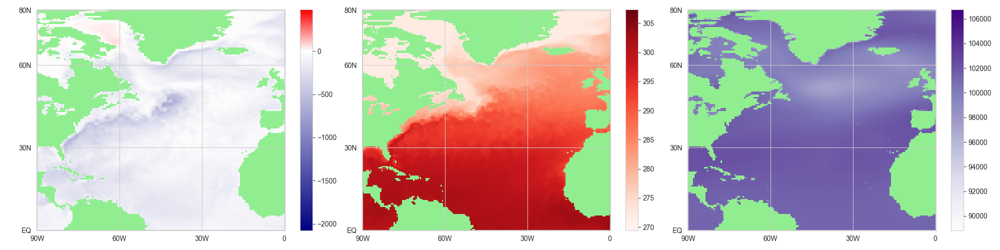
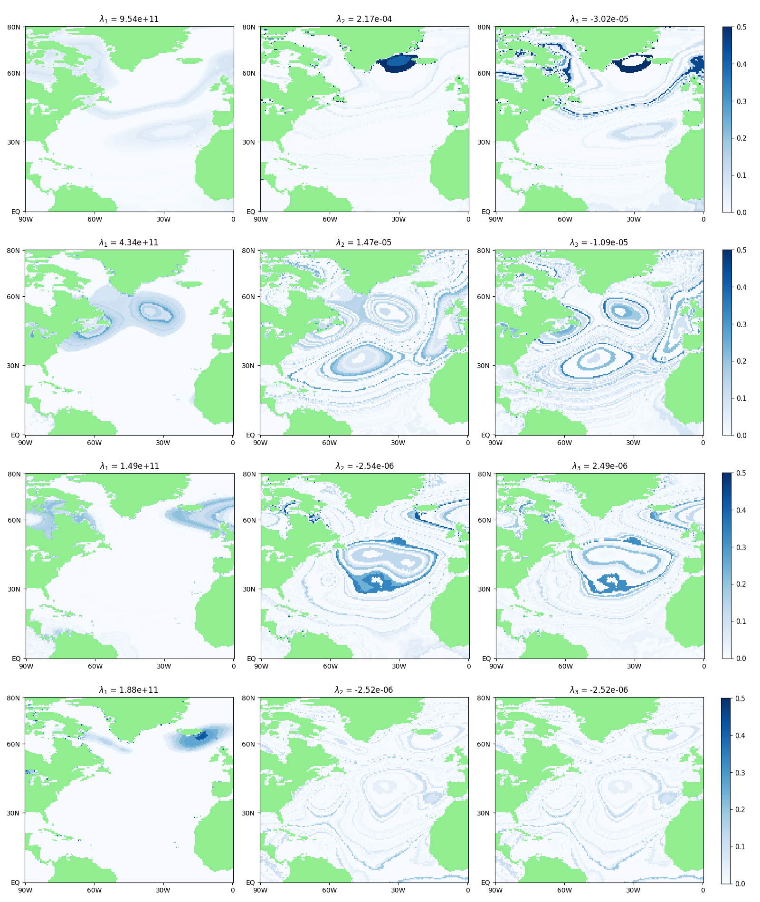

# Ocean_components

Python workflows for processing ERA5 reanalysis data, estimating stochastic-model coefficients, analysing stationary distributions and copulas, computing spatial eigenmodes, and forecasting ocean–atmosphere variables over the North Atlantic.

The main stochastic model is the Itô SDE

\[
 dX_t = a(t,X_t)\,dt + b(t,X_t)\,dW_t,
\]

where \(X_t\) represents one or more observed fields, \(a\) is the drift, \(b\) is the diffusion coefficient, and \(W_t\) is a Wiener process. The current workflows use daily ERA5-derived fields for sensible and latent heat fluxes, total heat flux (`Flux`), sea-surface temperature (`SST`), and surface pressure (`Pressure`). The nominal full-period dataset is 1979–2026; the final part of 2026 may be incomplete.

## 1. Repository layout

The Git repository contains source code and documentation. Large input arrays, intermediate products, model checkpoints, logs, and generated figures are stored separately under `DATA_ROOT` (see [Data and code locations](#2-data-and-code-locations)).

```text
Ocean_Components/
├── project_paths.py          # The single configuration point for the data directory
├── main.py                   # Numerical and data-processing task runner
├── main_plotter.py           # Plotting task runner
├── Coefficients/             # 1D/2D drift and diffusion estimation, bridges, BBT, C/F
├── Data_processing/          # ERA5/GRIB parsing, field I/O, collection, diagnostics
├── Eigenvalues/              # Spatial eigenvalue/eigenvector calculations
├── Functional/               # Stationary PDFs, hybrid tails, copulas, Fokker–Planck
├── Plotting/                 # Maps, coefficient plots, distributions, copulas, videos
├── Forecast_nn/              # Neural and generative forecasting models
├── Forecast_1d/              # Point-series extraction and 1D forecasting
├── Forecast_probs/           # Graph/probabilistic forecasting experiments
├── scripts/                  # Standalone audit and smoke-test utilities
├── tests/                    # Core regression and numerical tests
├── video examples/           # Selected example figures/videos
├── requirements.txt
└── README.md
```

`Cluster/` is intentionally excluded by `.gitignore`. It is a local, cluster-specific directory for Slurm (`.sbatch`) and Docker launcher files. It is not part of a normal Git checkout: keep a separate copy of those launchers on the cluster and restore it after cloning or replacing the repository. The tracked `Forecast_1d/jobs/` directory is separate from this local-only `Cluster/` directory.

### Main code areas

| Directory / file | Purpose |
|---|---|
| `project_paths.py` | Defines the code root and the one active data root. |
| `main.py` | Selects and runs numerical tasks: coefficient estimation/assembly, diagnostics, SDE conditions, stationary distributions, copulas, eigenvalues, and ERA5 processing. |
| `main_plotter.py` | Selects plotting tasks: fields, eigenmodes, mean-year maps, coefficient frames/videos, stationary PDFs, copulas, Fokker–Planck comparisons, and article figures. |
| `Coefficients/` | 1D and 2D NP/SP estimators, parallel period calculations, cross-period bridges, collection, \(BB^T\), and derived \(C/F/FS\) fields. |
| `Data_processing/` | GRIB parsing, daily field loading/collection, mean-year calculations, SDE-condition preparation, and data diagnostics. |
| `Functional/` | Stationary-density calculations, empirical/hybrid tail treatment, copula calculations, and 2D Fokker–Planck workflows. |
| `Eigenvalues/` | Eigenvalue/eigenvector and spectral workflows. |
| `Plotting/` | Plotting functions and workflow orchestration. Figure output is routed to `DATA_ROOT/Plots/`. |
| `Forecast_nn/` | Spatial neural forecasting, SDE-informed models, and generative forecasting. See its [dedicated README](Forecast_nn/README.md) and [generative-model notes](Forecast_nn/GENERATIVE_README.md). |
| `Forecast_1d/` | Extraction and forecasting of ten offshore point series. See [README_FORECASTING.md](Forecast_1d/README_FORECASTING.md). |
| `Forecast_probs/` | Earlier graph-based/probabilistic forecasting experiments. |

## 2. Data and code locations

**Keep the Git checkout and the data directory separate.** `project_paths.py` is the single source of truth for the data location. The code root is inferred automatically from the location of that file; it must not be set to the data directory.

Open `project_paths.py` and leave exactly one `DATA_ROOT` assignment active. The repository currently has the work-laptop path active:

```python
from pathlib import Path

# --- Choose ONE data directory and comment out the other two ---
DATA_ROOT = Path(r"D:/Nastya/Data/OceanFull/")       # Work laptop
# DATA_ROOT = Path("/home/aosipova/OceanFull/")      # Cluster
# DATA_ROOT = Path(r"C:/OceanFull/")                 # Second laptop
```

For the cluster, the intended layout is:

```text
/home/aosipova/
├── Ocean_Components/    # Git checkout: Python source and the local Cluster/ launchers
└── OceanFull/           # Data, coefficients, plots, checkpoints, and results
```

On the cluster, activate the second `DATA_ROOT` line and comment out the laptop paths. On either laptop, activate the corresponding Windows path. Do not put `OceanFull` inside the Git checkout and do not point `DATA_ROOT` at `Ocean_Components`.

`project_paths.py` exposes:

- `CODE_ROOT`: absolute path to the Git checkout;
- `DATA_ROOT`: absolute path to the selected data directory;
- `files_path_prefix`: the same data root as a string with a trailing separator, retained for older functions that concatenate paths.

Check the selected configuration from the repository root:

```bash
python -m project_paths
python -m project_paths --data-root
python -m project_paths --code-root
python -m project_paths --check
```

The `--check` option checks that the code checkout contains `Forecast_nn/` and that the configured data root and its `DATA/` directory exist. It does not validate every dataset or coefficient file; use `Forecast_nn.check_sources` for the forecasting inputs.

### Typical data-directory layout

The following is a guide to the principal data and output locations. Some optional folders are created only when their corresponding workflow is run.

```text
OceanFull/
├── DATA/
│   ├── Fluxes/
│   │   ├── sensible_1979-2026_grouped.npy
│   │   ├── latent_1979-2026_grouped.npy
│   │   └── Flux_1979-2026_grouped.npy
│   ├── SST/SST_1979-2026_grouped.npy
│   ├── Pressure/Pressure_1979-2026_grouped.npy
│   ├── GRIB/                  # Source GRIB files, when retained
│   └── mask                  # Binary ocean mask
├── Coefficients/              # Period and assembled coefficient arrays
├── Eigenvalues/               # Calculated spectral data
├── Functional/                # Stationary PDFs, copulas, FP data, diagnostics
├── Plots/                     # All generated figures and videos
└── Forecast/
    └── Results/               # Forecast checkpoints, predictions, and metrics
```

The suffix `1979-2026` identifies the nominal data period; it does **not** mean that the final observation is 2026-12-31. The actual final date is inferred from the array length. In particular, do not assume a complete 2026 calendar year when aligning observations, coefficients, or forecast splits.

### Coefficient storage and compatibility paths

The assembled full-period 2D coefficient arrays are stored under the period directory, for example:

```text
Coefficients/1979-2026/sensible_latent/
├── A_1979-2026_sp.npy
├── B_1979-2026_sp.npy
├── B_with_reg_1979-2026_sp.npy
├── A_1979-2026_np.npy
└── B_1979-2026_np.npy
```

One-dimensional arrays are stored under the corresponding period and variable, for example:

```text
Coefficients/1979-2026/1d_bins_144/sensible/Semiparametric/
├── A_<first>-<last>.npy
└── B_<first>-<last>.npy
```

Decadal coefficient estimates and their daily/collected inputs remain in their period-specific directories. The bridge workflow assembles the available periods and their boundary transitions into the full-period arrays.

**`Coefficients/continuous/` is retained in the current code and data layout. Do not remove it as part of this README update.** It contains manifests used by existing workflows, derived `C/F/FS` products, and backward-compatible paths for some assembled 2D `A/B` arrays. Depending on the filesystem, those legacy paths can be hard links, symbolic links, or physical copies of the canonical arrays under `Coefficients/1979-2026`. A physical-copy fallback can therefore consume additional disk space. The current storage behavior is intentionally unchanged; this note is informational only.

## 3. Installation

Clone the repository and work from its root directory (the directory containing `project_paths.py`):

```bash
git clone https://github.com/Alandriya/Ocean_components.git
cd Ocean_components
python -m venv .venv
```

Activate the environment:

```bash
# Linux / macOS
source .venv/bin/activate

# Windows PowerShell
.venv\Scripts\Activate.ps1
```

Install the common dependencies:

```bash
python -m pip install --upgrade pip
python -m pip install -r requirements.txt
```

Additional runtime requirements:

- `Forecast_nn/` uses PyTorch. Install a PyTorch build compatible with the local CPU/GPU and CUDA environment; it is managed separately from the common `requirements.txt`.
- GRIB decoding in `Data_processing/grib.py` requires `eccodes` (`python -m pip install eccodes`).
- Some optional forecasting backends or experiments may require additional packages; consult the README in the corresponding subproject.

After selecting `DATA_ROOT`, run `python -m project_paths --check` before starting a long calculation.

## 4. Numerical workflows: `main.py`

`main.py` is the entry point for numerical calculations and data-processing tasks. Select one task by editing the `task` assignment in the corresponding parameter section. Task-specific settings are grouped nearby; common settings are collected near the bottom of the file.

```python
task = "bridge_coefficients"
```

The current task catalogue includes:

| Task | Purpose |
|---|---|
| `coefficients` | Estimate 1D and/or 2D daily NP/SP drift and diffusion coefficients. Parallel CPU workers and collection options are configured in the same section. |
| `bridge_coefficients` | Calculate missing transitions at period boundaries and assemble continuous 1D/2D coefficient arrays. |
| `bbt`, `validate_bbt` | Calculate and validate the diffusion covariance product \(BB^T\). |
| `derived_cf` | Calculate rolling derived `C`, `F`, and `FS` fields from continuous 2D coefficients. |
| `eigenvalues`, `collect_eigenvalues` | Calculate spectral modes and collect period results. |
| `sde_conditions` | Calculate SDE constants/conditions for selected variable pairs. |
| `mean_year` | Calculate annual mean fields. |
| `stationary` | Estimate one-dimensional stationary-distribution characteristics. |
| `copulas` | Estimate copula-related characteristics for selected variables. |
| `fokker_planck_2d_prepare`, `fokker_planck_2d_solve` | Prepare and solve the 2D stationary Fokker–Planck problem. |
| `article_prepare`, `article_figures`, `article_all`, `article_isolines`, `article_regions`, `article_classes` | Prepare cached article diagnostics or regenerate selected manuscript figures. `article_all` also includes copula figures. |
| `quantile_diagnostics`, `quantile_diagnostics_1d` | Run daily 2D or 1D quantile diagnostics. |
| `quantile_hourly`, `quantile_hourly_resampling` | Analyse hourly GRIB data and the effect of temporal/spatial thinning. |
| `grib`, `grib-check` | Process GRIB input or compare old and new grouped arrays. |
| `collect` | Collect selected period variables into a single array. |
| `extract_1d_series` | Extract configured offshore point series and neighbourhood data. |

The current `main.py` selects `sde_conditions` by default. Change `task` explicitly before running if another calculation is intended.

### Period selection

Both `main.py` and `main_plotter.py` currently use `start_year = 19792026` as a sentinel for the full 1979–2026 interval. The entry point converts it to `start_year = 1979`, `end_year = 2026`. For a decadal calculation, set `start_year` to the decade's first year (for example, `2009` selects 2009–2019); the final period beginning in 2019 ends in 2026. The actual final observation date is still determined by the available data.

## 5. Plotting workflows: `main_plotter.py`

`main_plotter.py` reads previously calculated data and produces figures; it does not run the numerical coefficient-estimation task. Select a plotting task in its corresponding section:

| Task | Output |
|---|---|
| `variables` | Maps of the selected fields. |
| `eigenvalues` | Eigenvalue/eigenvector and spectral-mode figures. |
| `mean_year` | Annual mean maps. |
| `coefficient_frames` | Individual coefficient maps for a selected time interval. |
| `videos` | Videos assembled from previously generated coefficient frames. |
| `stationary` | Stationary densities with observed-data histograms. |
| `stationary_hybrid` | Hybrid stationary densities with the central FP fit and empirical/GPD tail treatment. |
| `copulas` | Saved copula and joint-density visualizations. |
| `functional_fits` | Drift/diffusion functional-fit diagnostics. |
| `fokker_planck_2d_compare` | Empirical versus 2D Fokker–Planck stationary density comparisons. |
| `fokker_planck_2d_convergence` | Comparison of already-solved spatial resolutions. |
| `hybrid_fp2d_marginal_overlay` | Hybrid and 2D FP marginal-density comparison. |
| `article_figures`, `article_isolines`, `article_regions`, `article_classes`, `article_all` | Manuscript figures 1–3, selected subsets, or all figures including copulas 4–8. |

The current `main_plotter.py` selects `hybrid_fp2d_marginal_overlay` by default. Change `task` explicitly before running if another plot is intended.

All project figures are routed through `Plotting/paths.py` to the configured data directory's `Plots/` folder, with thematic subdirectories. This includes figures produced by legacy plotting functions. The `video examples/` directory in the Git repository contains selected examples, not the live output directory.

## 6. Neural forecasting: `Forecast_nn/`

`Forecast_nn/` contains the main gridded forecasting framework. Its default targets are sensible and latent heat flux; `Flux`, `SST`, and `Pressure` are also registered for later experiments. The grouped input paths are resolved from `DATA_ROOT` by `Forecast_nn/source_paths.py` and `Forecast_nn/config.py`.

The expected full-period grouped arrays include:

```text
DATA/Fluxes/sensible_1979-2026_grouped.npy
DATA/Fluxes/latent_1979-2026_grouped.npy
DATA/Fluxes/Flux_1979-2026_grouped.npy
DATA/SST/SST_1979-2026_grouped.npy
DATA/Pressure/Pressure_1979-2026_grouped.npy
```

For SDE-informed experiments, the code can also read the full-period 1D coefficient arrays and the joint 2D sensible–latent `A/B` arrays. The joint 2D `B` channel convention used by the current forecasting code is diagonal-first: `[B11, B22, B12, B21]`.

First validate the configured inputs and coefficient paths. This checks NPY headers and lengths without loading the full multi-year arrays into RAM:

```bash
python -m Forecast_nn.check_sources
```

Typical training and evaluation commands:

```bash
# Train a gridded model for sensible heat flux
python -m Forecast_nn.train --model simvp --variable sensible --amp

# Evaluate on validation data
python -m Forecast_nn.test --model simvp --variable sensible --split val

# Train/evaluate a model for latent heat flux
python -m Forecast_nn.train --model simvp --variable latent --amp
python -m Forecast_nn.test --model simvp --variable latent --split val
```

Other registered architectures, SDE-informed variants, DDPM/GAN/EOF-VAR experiments, and DDM-inspired models have separate command-line entry points. See [Forecast_nn/README.md](Forecast_nn/README.md) and [Forecast_nn/GENERATIVE_README.md](Forecast_nn/GENERATIVE_README.md) for model options, SDE inputs, checkpoint conventions, logs, and experiment-specific commands. GPU training requires a suitable PyTorch/CUDA environment.

## 7. Point forecasting: `Forecast_1d/`

`Forecast_1d/` is a separate workflow for ten offshore point series extracted from the full sensible/latent fields. It includes persistence and input-mean baselines and SARIMA forecasting. The point dataset is created from the grouped ERA5 fields and ocean mask; it is stored under the data root, not in the Git checkout.

```bash
# Validate extraction inputs without writing the dataset
python -m Forecast_1d.extract_points --dry-run

# Extract the point dataset
python -m Forecast_1d.extract_points

# Fit SARIMA parameters
python -m Forecast_1d.train --model sarima

# Evaluate baselines and SARIMA
python -m Forecast_1d.test --model all --split val
python -m Forecast_1d.test --model all --split test
```

See [Forecast_1d/README_FORECASTING.md](Forecast_1d/README_FORECASTING.md) for chronological splits, supported backends, saved-result structure, plotting, and cluster launch examples.

## 8. ERA5 GRIB processing

The streaming parser in `Data_processing/grib.py` reads GRIB messages without loading the complete multi-year file into memory. It can process one requested variable at a time, validates timestamps, and groups the selected UTC observations (normally 00, 06, 12, and 18 UTC) into one daily mean. Its output arrays are written under the configured data root.

Install the GRIB decoder and inspect the parser options:

```bash
python -m pip install eccodes
python -m Data_processing.grib --help
```

Alternatively, select `task = "grib"` or `task = "grib-check"` in `main.py` and configure the GRIB input paths and variable names in the corresponding parameter block. Incomplete final days are not treated as complete four-observation daily means.

## 9. Legacy probabilistic forecasting: `Forecast_probs/`

`Forecast_probs/` contains an earlier graph-based forecasting experiment. It is separate from the current `Forecast_nn` grouped-array pipeline. In particular, `Forecast_probs/graph_runner.py` expects the legacy `DATA/FLUX_mini_diff.npy` input and `DATA/mask`; that file is not automatically generated from the modern `sensible/latent/Flux_1979-2026_grouped.npy` arrays.

## 10. Tests and diagnostics

The repository contains regression and synthetic-data tests in:

- `tests/` — coefficient bridges/collection, stationary distributions, tails, copulas, Fokker–Planck, GRIB, quantile diagnostics, and data alignment;
- `Forecast_nn/tests/` — neural forecasting, SDE inputs/losses, generative models, and logging;
- `Forecast_1d/tests/` — point extraction and forecasting.

Standalone audit and smoke-test scripts are in `scripts/`. Many tests use synthetic inputs and do not require the full ERA5 archive. Install `pytest` in the development environment to run the pytest-style tests, for example:

```bash
python -m pytest tests Forecast_nn/tests Forecast_1d/tests -q
```

For a lightweight pre-run check of the paths and forecast sources:

```bash
python -m project_paths --check
python -m Forecast_nn.check_sources
```

## 11. Selected visual examples

The following images are examples committed to the repository. Newly generated figures are saved under `DATA_ROOT/Plots/`.





## 12. Related publications

If you use this repository in your work, please consider citing the relevant publications:

- Gorshenin A. K., Osipova A. A., Belyaev K. P. “Stochastic analysis of air-sea heat fluxes variability in the North Atlantic in 1979–2022 based on reanalysis data.” *Computers and Geosciences*, 2023, vol. 181, article 105461. [https://doi.org/10.1016/j.cageo.2023.105461](https://doi.org/10.1016/j.cageo.2023.105461)
- Belyaev K., Gorshenin A., Korolev V., Osipova A. “Comparison of statistical approaches for reconstructing random coefficients in the problem of stochastic modeling of air–sea heat flux increments.” *Mathematics*, 2024, vol. 12, no. 2, article 288. [https://doi.org/10.3390/math12020288](https://doi.org/10.3390/math12020288)
- Gorshenin A. K., Osipova A. A., Belyaev K. P. “Eigenvector decomposition for joint analysis of spatial characteristics in the North Atlantic from 1979 to 2024.” *Computers & Geosciences*, 2026, vol. 207, article 106062. [https://doi.org/10.1016/j.cageo.2025.106062](https://doi.org/10.1016/j.cageo.2025.106062)
- Osipova A. A. “Statistical analysis of the equivalence of algorithms for estimating the parameters of dynamical-stochastic models of ocean–atmosphere turbulent heat exchange.” *Systems and Means of Informatics*, 2026, vol. 36, no. 2, pp. 40–61. [https://doi.org/10.14357/08696527260203](https://doi.org/10.14357/08696527260203)
